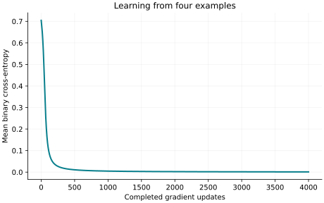

# Neural Math Lab

A small neural network you can understand line by line. Learn XOR with **NumPy, explicit derivatives, and ordinary gradient descent**, then inspect an offline report with training plots and the actual numbers flowing through each layer.

This is an introductory AI/ML project by [TARUNTEjjjj](https://github.com/TARUNTEjjjj), connecting the mathematical focus of AxiomMath and Axiom SAT with hands-on Python. It is a separate experiment; it does not change those applications.

For a preview before installing anything, open the included **[`examples/xor/report.html`](examples/xor/report.html)** locally in a browser. The [recorded experiment](examples/xor/metrics.json) uses the defaults below. GitHub displays HTML source rather than running the report; download or clone the repository to view it.



## Start here

You need Python 3.9 or newer, a terminal, and an internet connection for the initial dependency installation. A current supported Python release is recommended. Training and reading reports then work offline on a CPU; no GPU, account, dataset download, or API key is required.

Open a terminal inside this repository:

```sh
python3 -m venv .venv
source .venv/bin/activate
python -m pip install --upgrade pip
python -m pip install -e .
python -m neural_math_lab gradient-check
python -m neural_math_lab train
```

On Windows, activate with `.venv\Scripts\Activate.ps1` in PowerShell instead.

Open **`runs/xor/report.html`** in your browser. On macOS you can run:

```sh
open runs/xor/report.html
```

The report includes the training curve, a map of the fitted function, the four predictions, and a trace of one input through the network. It contains its own figures and opens without a server or internet connection. Keep or share a report only when you intend to share that experiment's weights and results.

## What you will learn

1. **Forward propagation:** turn inputs and parameters into a prediction.
2. **Loss:** measure the difference between predictions and known targets.
3. **Backpropagation:** use the chain rule to compute each parameter's derivative.
4. **Gradient descent:** update the parameters to reduce loss.
5. **Verification:** compare derivatives against finite differences, inspect failures, and make experiments reproducible.

Read [the mathematics walkthrough](docs/mathematics.md), then try [the exercises and answers](docs/exercises.md). The walkthrough assumes comfort with basic algebra and derivatives, but explains programming notation and array shapes.

The model has two inputs, one hidden layer with four `tanh` neurons by default, and a sigmoid output. With four hidden neurons, it learns 17 parameters: 8 input weights, 4 hidden biases, 4 output weights, and 1 output bias. NumPy supplies arrays and arithmetic; the project implements every derivative and update itself.

## Inspect and change an experiment

```sh
python -m neural_math_lab explain --model runs/xor/model.json --input 1 0
python -m neural_math_lab train --learning-rate 0.05 --output runs/slower
python -m neural_math_lab train --hidden 2 --seed 7 --output runs/two-neurons
python -m neural_math_lab --help
```

An existing output directory is preserved: choose a new `--output` directory for each experiment. The defaults are 4,000 epochs, learning rate 0.5, four hidden neurons, and seed 7. An epoch is one full-batch update using all four XOR rows. History records epoch 0 before any updates and each completed update afterward.

Each output folder contains:

| File | Purpose |
| --- | --- |
| `report.html` | Self-contained visual walkthrough of this run |
| `loss.svg`, `decision.svg` | Exportable plots |
| `model.json` | Readable weights and biases; no executable pickle data |
| `metrics.json` | Configuration, dependency versions, losses, and predictions |
| `history.csv` | Loss and training accuracy at every epoch |

Predicted class is 1 when the sigmoid output is at least 0.5. That output is **not calibrated confidence**. All four XOR rows are used for fitting and evaluation: this is a demonstration of learning a truth table, **not a held-out test or evidence of generalization**. The smooth prediction map between binary inputs illustrates the learned function; XOR does not define labels there. Some settings and initializations may fail to learn.

## Run the tests

```sh
python -m unittest discover -s tests -v
```

Tests cover hand-computed predictions, independent numerical gradient checks for every parameter, extreme logits, averaging across batches, training behavior, invalid inputs, safe model loading, and the full command-to-report workflow. GitHub Actions runs the suite and a complete experiment on Linux and macOS. [Verification notes](docs/verification.md) record the checks actually run for this release.

The numerical gradient check approximates each derivative by evaluating the loss at `parameter + epsilon` and `parameter - epsilon`. It does not reuse the backpropagation implementation to calculate the reference value.

## Read the source in this order

| File | What to look for |
| --- | --- |
| `neural_math_lab/core.py` | Dataset, initialization, forward pass, loss, gradients, updates, numerical checking |
| `neural_math_lab/cli.py` | How command-line options connect those steps |
| `neural_math_lab/storage.py` | Explicit JSON model format and validation |
| `neural_math_lab/report.py` | Figures and report generated from actual results |
| `tests/test_core.py` | Independent checks on the mathematics |

The initial scope is deliberately one small network and one fully specified task. A useful later step is a two-dimensional synthetic dataset with separate training, validation, and test sets; it is not part of this release.

## Sources and attribution

The derivations, explanations, code, and exercises in this repository are original. Further reading:

- [Stanford CS231n: backpropagation and the chain rule](https://cs231n.github.io/optimization-2/).
- [NumPy: `logaddexp`](https://numpy.org/doc/stable/reference/generated/numpy.logaddexp.html), used for a stable loss calculation.
- [PyTorch: automatic differentiation](https://docs.pytorch.org/tutorials/beginner/basics/autogradqs_tutorial.html), for comparison after understanding the manual version.

The repository is intended to remain private unless its owner chooses otherwise. There is no public deployment or telemetry. Dependencies have their own licenses. No third-party dataset is included; XOR is generated directly from its truth table.
