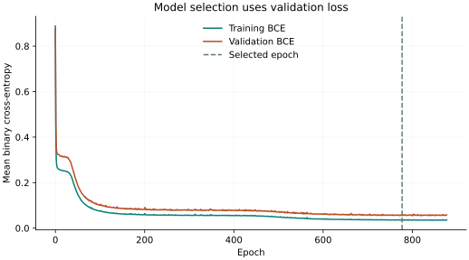

# Neural Math Lab

Understand a neural network from its equations, then test whether it learns a pattern beyond its training examples. Neural Math Lab implements **forward propagation, backpropagation, SGD, and Adam directly in NumPy**. Its offline reports let you replay training checkpoints, compare a neural network with logistic regression, explore decision costs, and differentiate predictions with respect to raw inputs.

This private learning project belongs to [TARUNTEjjjj](https://github.com/TARUNTEjjjj). It connects the mathematical focus of AxiomMath and Axiom SAT with practical Python and reproducible ML experiments.

## Open a finished experiment first

Download or clone the repository and open one of these files locally in a browser:

- **[Moons experiment](examples/moons/report.html):** two curved classes, checkpoint replay, and held-out evaluation.
- **[Circles experiment](examples/circles/report.html):** concentric classes that make the difference from a straight-line baseline visible.
- **[XOR introduction](examples/xor/report.html):** four examples with every layer's actual calculations exposed.

GitHub displays the HTML source rather than running the reports. Once downloaded, each report opens directly from disk without a web server, account, or internet connection. All scripts, styles, figures, and experiment data are embedded. Replay needs JavaScript; recorded metrics and a static learning-curve figure remain readable without it.

The controls inspect a **recorded experiment**. They do not retrain the model in your browser. Use the Python commands below to change the experiment and produce a new report.



## Run your own experiment

You need Python 3.9 or newer; a current supported Python release is recommended. Dependencies are NumPy and Matplotlib. Installation needs internet access, but training then runs locally on a CPU. No GPU, dataset download, model API, or API key is required.

Open a terminal inside the repository:

```sh
python3 -m venv .venv
source .venv/bin/activate
python -m pip install --upgrade pip
python -m pip install -e .
python -m neural_math_lab experiment --dataset moons --output runs/moons
```

On Windows, activate with `.venv\Scripts\Activate.ps1` in PowerShell instead. Open `runs/moons/report.html` in your browser. On macOS:

```sh
open runs/moons/report.html
```

The default output directory is `runs/<dataset>`, so `experiment --dataset circles` uses `runs/circles`. An existing directory is preserved: choose a new `--output` path for each run.

### What the advanced report shows

- **Checkpoint replay:** watch the saved decision boundary change, then return to the validation-selected model. Final metric cards stay fixed while replaying.
- **Point inspector:** click the map or enter raw coordinates; inspect their standardized values, hidden activations, output logit, and sigmoid value.
- **Data split controls:** display training, validation, or held-out test points, and mark classification mistakes.
- **Model comparison:** switch between the neural network and the separately trained logistic baseline.
- **Diagnostics:** read training/validation loss, confusion counts, accuracy, precision, recall, F1, Brier score, and misclassified test examples.
- **Decision lab:** explore thresholds on validation rows, compare false-positive and false-negative costs, and restore the threshold selected in Python. A separate held-out summary uses that frozen threshold.
- **Ranking and reliability:** inspect ROC AUC, precision–recall and average precision, reliability bins, and class-1 probability ECE. Undefined metrics and empty bins are identified explicitly.
- **Input sensitivity:** follow the chain rule through standardization, `tanh`, and sigmoid; compare a local linear approximation with an actual perturbed prediction.
- **Provenance:** inspect settings, seeds, dependency versions, selected epoch, and stopping reason.

The browser's prediction calculations are checked against the saved Python predictions. The exportable SVG figures and full machine-readable history remain available alongside the report.

### Change one setting at a time

```sh
python -m neural_math_lab experiment --dataset circles --output runs/circles
python -m neural_math_lab experiment --hidden 4 --output runs/moons-small
python -m neural_math_lab experiment --l2 0.05 --output runs/moons-regularized
python -m neural_math_lab experiment --optimizer sgd --learning-rate 0.05 --output runs/moons-sgd
python -m neural_math_lab experiment --fp-cost 1 --fn-cost 3 --output runs/moons-cost-3
python -m neural_math_lab experiment --help
```

The advanced defaults are 600 examples, coordinate noise 0.15, 16 hidden `tanh` neurons, seed 7, Adam with learning rate 0.01, batch size 32, L2 coefficient 0.001, and at most 1,200 epochs. Patience is 100 epochs and `min_delta` is `1e-5`.

Each class is split approximately **60% training / 20% validation / 20% test**, with integer rounding. The scaler is fitted only on training rows. Mini-batch updates use only training rows. Validation loss selects the saved parameters and controls early stopping; the test partition is evaluated after selection. The returned model restores the actual lowest-validation-loss checkpoint, which can differ from the last executed epoch. The guide explains how `min_delta` separately controls patience.

Both models use the same split and scaler, with the same optimizer and hyperparameter budget, but each selects its own epoch using validation loss. This comparison does not exhaust the best possible tuning of either model.

After selecting weights, each model chooses its decision threshold using **validation cost only**. The cost is `(fp_cost × FP + fn_cost × FN) / N`; both costs default to 1. Equal-cost candidates prefer the threshold closest to 0.5, then the higher threshold. The chosen threshold is frozen before test evaluation. Changing the report's threshold controls explores validation behavior without rewriting the held-out result. Original accuracy cards and boundary replay retain their stated threshold of 0.5.

The decision lab's diagnostics describe the selected model, independent of checkpoint replay. AUC measures ranking, ECE depends on bins, and Brier measures squared probability error; none alone establishes calibrated confidence. Read the worked four-row example before interpreting these metrics on a larger experiment.

## Read the mathematics in three stages

Start with the smaller network if derivatives and array shapes are still unfamiliar:

1. [The XOR mathematics walkthrough](docs/mathematics.md): weights, biases, matrix shapes, the chain rule, a numerical update, and gradient checking.
2. [Ten introductory exercises with answers](docs/exercises.md).
3. [Beyond XOR](docs/advanced-mathematics.md): train/validation/test separation, standardization, mini-batches, L2, Adam bias correction, early stopping, baselines, and metrics.
4. [Eight advanced experiments and worked answers](docs/advanced-exercises.md).
5. [From a probability to a decision](docs/decision-mathematics.md): validation-only threshold selection, cost tradeoffs, ties, ROC/AUC, AP, reliability, and raw-input derivatives with numerical examples.
6. [Eight decision-lab exercises with worked answers](docs/decision-exercises.md).

The original XOR commands remain available:

```sh
python -m neural_math_lab gradient-check
python -m neural_math_lab train --output runs/xor
python -m neural_math_lab explain --model runs/xor/model.json --input 1 0
```

XOR defaults to four hidden neurons, 4,000 full-batch updates, learning rate 0.5, and seed 7. All four Boolean examples participate in fitting, so its displayed accuracy is **training accuracy**, not held-out accuracy. It is the first lesson in computing and checking the derivatives.

For an advanced model, explain a raw input through the saved preprocessing and network together:

```sh
python -m neural_math_lab explain --model runs/moons/pipeline.json --input 0.5 0.2
```

The command prints the training mean and scale, standardized input, learned weights, and each intermediate layer. `pipeline.json` preserves the preprocessing required to interpret the weights correctly. Model files contain validated JSON numbers; loading does not execute pickle objects.

Saving validates the model before replacing an existing file. Model and pipeline
saves write a complete temporary file beside the destination before atomic
replacement, so validation or write failures preserve the previous saved model.

## Recorded example results

The committed examples use the advanced defaults above. Each test partition contains 120 rows that were not used for parameter updates or validation selection.

| Recorded experiment | Neural test accuracy | Linear baseline test accuracy | Neural selected / stopped epoch |
| --- | --- | --- | --- |
| [Moons](examples/moons/metrics.json) | 96.67% — 116/120 | 92.5% — 111/120 | 777 / 877 |
| [Circles](examples/circles/metrics.json) | 97.5% — 117/120 | 47.5% — 57/120 | 374 / 474 |

These are measured results on **one synthetic split and seed per dataset**, not promises for other settings or real-world data. A sigmoid output is not calibrated confidence. Choosing future settings by repeatedly inspecting these test scores would make the test set part of development; use validation for selection and fresh evaluation data for a later final claim.

## Files produced by an advanced experiment

| File | Purpose |
| --- | --- |
| `report.html` | Self-contained interactive report, including replay data |
| `pipeline.json` | Selected neural weights, training-only scaler, and dataset identifier |
| `metrics.json` | Settings, split metrics, baseline results, compact decision diagnostics, selected/stopped epochs, and environment |
| `diagnostics.json` | Validation-selected thresholds and costs, frozen test summaries, ranking curves, and reliability bins for both models |
| `experiment.json` | Complete data and split IDs, history, checkpoints, baseline, selected model, and test predictions |
| `history.csv` | Full training/validation metrics and gradient norm at every recorded epoch |
| `learning.svg`, `decision.svg` | Exportable learning curve and selected-model prediction figure |

The XOR command instead produces `model.json`, `metrics.json`, `history.csv`, `loss.svg`, `decision.svg`, and its introductory `report.html`. Generated runs belong under the ignored `runs/` directory; the selected demonstration artifacts live in `examples/`.

Reports include their experiment's coordinates, labels, weights, and results. Share a report only when you intend to share those contents. This project's examples are generated synthetic data.

## Test the implementation

```sh
python -m unittest discover -s tests -v
node --test tests/test_report.js
```

Node.js 22 or newer is recommended for the browser-logic tests; it is not needed for Python training or for opening a report. No npm dependencies are required.

Tests cover independently computed derivatives, numerical stability, optimizer arithmetic, regularization gradients, split disjointness, training-only scaling, test-data isolation, best-checkpoint restoration, JSON pipeline round trips, real CLI runs, report artifacts, and browser/Python prediction agreement. The central-difference gradient checks calculate their reference values from perturbed losses rather than reusing backpropagation.

GitHub Actions is configured to run on Linux and macOS, including a Python 3.9 compatibility job, and exercises report generation from an installed package outside the source checkout. See [verification notes](docs/verification.md) and the workflow run for the exact commit's observed results.

## Read the source

| File | Responsibility |
| --- | --- |
| `neural_math_lab/core.py` | Inspectable network, stable forward/loss calculations, manual backpropagation, XOR training, gradient checking |
| `neural_math_lab/datasets.py` | Synthetic generation, stratified split IDs, and training-only standardization |
| `neural_math_lab/experiment.py` | SGD/Adam, L2, validation selection, baseline, and evaluation |
| `neural_math_lab/diagnostics.py` | Cost-sensitive thresholds, tie-aware ranking metrics, reliability bins, and raw-input sensitivity |
| `neural_math_lab/storage.py` | Validated network and preprocessing pipeline JSON |
| `neural_math_lab/cli.py` | Runnable training, experiment, explanation, and gradient-check commands |
| `neural_math_lab/experiment_report.py` | Advanced artifacts and scientific figures from actual run data |
| `neural_math_lab/assets/` | Embedded report layout, style, checkpoint replay, and point calculations |
| `neural_math_lab/report.py` | Introductory XOR report |
| `tests/` | Independent mathematical, data-boundary, CLI, persistence, and browser-logic checks |

## Sources and attribution

The explanations and implementation are original. Further reading:

- [Stanford CS231n: backpropagation and the chain rule](https://cs231n.github.io/optimization-2/).
- [Adam: A Method for Stochastic Optimization](https://arxiv.org/abs/1412.6980), Diederik P. Kingma and Jimmy Ba.
- [NumPy: `logaddexp`](https://numpy.org/doc/stable/reference/generated/numpy.logaddexp.html), used for stable loss calculations.
- [PyTorch: automatic differentiation](https://docs.pytorch.org/tutorials/beginner/basics/autogradqs_tutorial.html), for comparison after understanding the manual version.

The repository is intended to remain private unless its owner chooses otherwise. There is no public deployment or telemetry. Dependencies have their own licenses. XOR, moons, and circles are generated locally; no third-party dataset is redistributed.
